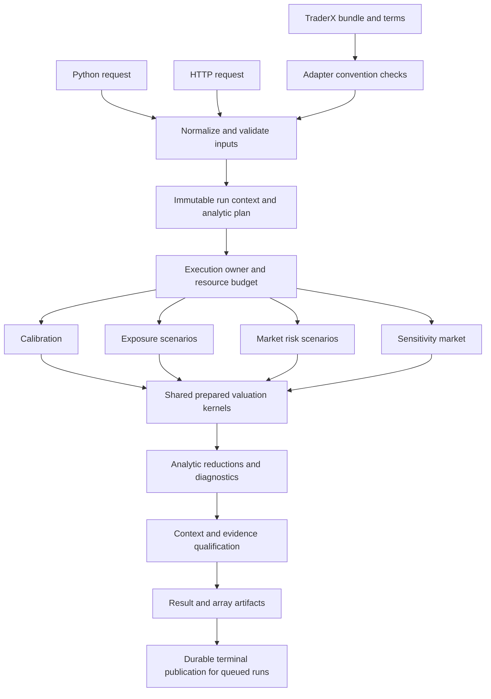

# Project audit

Date: 2026-10-10. Base Git revision at the final source checks: `53f85b970586089b51e3309c2d0437d1dcb647b0`.

## Disposition (2026-10-11)

Each finding was checked against the code at `c6e59da`, and those marked *run* by executing
the engine. Each now lives in the [issue register](known-issues.md) (or a feature) and is
ordered by the [roadmap](roadmap.md); the report below is kept as written, and this table is
the only part of it that is maintained. Severities are the register's
([README](README.md#entries): High is a wrong number on an ordinary input, or another caller's
result served), so some differ from the audit's.

| Finding | Verdict | Severity | Now |
|---|---|---|---|
| AUD-01 VaR rank | Confirmed, *run* (VaR 15 against ORE's 16). Narrow: no level among 0.9 to 0.999 meets the boundary at any N up to 200,000 | Low | [I-102](known-issues.md#i-102), fixed 2026-10-11 |
| AUD-02 Currencies in market risk | Confirmed | High | [I-100](known-issues.md#i-100), fixed 2026-10-11 |
| AUD-03 Quantile keys | Confirmed, *run* (`0.95` and `0.9500000001` both `95`) | Low | [I-102](known-issues.md#i-102), fixed 2026-10-11 |
| AUD-04 Confidence domain | The broader domain is kept and documented as broader than ORE's | Low | [I-102](known-issues.md#i-102), done 2026-10-11 |
| AUD-05 Input validation | Confirmed, *run*: an unsorted curve prices 50,697 against 51,133 with no error | Medium | [I-103](known-issues.md#i-103) |
| AUD-06 Calibration acceptance | Confirmed: only the ceiling is checked, at t=0; nothing on the paths | Medium | [I-73](known-issues.md#i-73), widened |
| AUD-07 Zero volatility in calibration | Confirmed (0/0 at an ATM helper) | Medium | [I-73](known-issues.md#i-73) |
| AUD-08 Zero-variance European | Confirmed; only under `ConstantVariance` with a zero volatility | Low | [I-104](known-issues.md#i-104) |
| AUD-09 Zero and negative notionals | Confirmed, *run*, and worse than reported: a negative-notional Bermudan is a long option on the reversed swap (+15,018 where the short is −35,713), a European the short; zero notional NaN | High | [I-101](known-issues.md#i-101), fixed 2026-10-11 |
| AUD-10 Late exercise | Confirmed, *run* (`StopIteration`) | Medium | [I-103](known-issues.md#i-103) |
| AUD-11 Delayed last payment | Confirmed; a window of the days between maturity and payment | Low | [I-104](known-issues.md#i-104) |
| AUD-12 Theta fixings | Confirmed; only when `theta_days` reaches a coupon fixing and paying inside the roll | Low | [I-104](known-issues.md#i-104) |
| AUD-13 Root solver contract | In part. The missing fit check is real ([I-73](known-issues.md#i-73)). Set aside: a general status from a fixed-step solver (its design, A-21: a root beyond a bounded bracket is that end, and the calibration's acceptance judges it); derivatives at a clipped root (the unbounded problems widen to 2^63; bounded bootstrap roots carry no tangent) | — | [I-73](known-issues.md#i-73) |
| AUD-14 H at small reversion | Confirmed; float32 only, about one rounding of a log discount | Low | [I-104](known-issues.md#i-104) |
| AUD-15 Qualification matrix | Valid (documentation) | Low | [I-110](known-issues.md#i-110) |
| AUD-16 Bermudan path parity | Known and planned | Medium | [I-32](known-issues.md#i-32), [I-49](known-issues.md#i-49) |
| AUD-17 AD versus bump Greeks | Known and planned | Medium | [I-51](known-issues.md#i-51), [I-78](known-issues.md#i-78) |
| AUD-18 Generic index conventions | Known scope; unsupported indices are refused by name | — | [I-05](known-issues.md#i-05), [I-54](known-issues.md#i-54) |
| AUD-19 Standard errors assume independence | Valid | Medium | [I-55](known-issues.md#i-55), extended; labelled on results and the rest moved to [I-111](known-issues.md#i-111) when I-55 closed (2026-10-11) |
| AUD-20 Precision qualification on results | Known and planned | Medium | [I-55](known-issues.md#i-55) (closed 2026-10-11: the evidence table and its warnings) |
| AUD-21 Empty portfolio warnings | Confirmed (`warnings=[]`) | Medium | [I-55](known-issues.md#i-55) (closed 2026-10-11: precision warnings), [I-73](known-issues.md#i-73) |
| AUD-22 Bundle identity | Confirmed; needs a bundle that breaks the contract's identity rule | Medium | [I-107](known-issues.md#i-107) |
| AUD-23 Publication retry | Confirmed; also staging errors escape `PublicationError`. A hung retry, no wrong number | Medium | [I-109](known-issues.md#i-109) |
| AUD-24 Cross-process binding | Confirmed; the store's docs already say one process | Medium | [I-08](known-issues.md#i-08), extended |
| AUD-25 Failed lookup after restart | Confirmed | Medium | [I-08](known-issues.md#i-08) |
| AUD-26 Directory fsync | Confirmed | Low | [I-08](known-issues.md#i-08) |
| AUD-27 to AUD-31 Bundle rows and outcomes | Confirmed (non-finite numbers parse; the row's coupon is never compared with the terms'; duplicate rows; structural errors; payload keys) | Medium | [I-108](known-issues.md#i-108) |
| AUD-32 Ignored EOD settings | Known and planned | Medium | [I-59](known-issues.md#i-59) |
| AUD-33 TraderX's own pricers | Known and planned; the import-layer consequence added | Medium | [I-93](known-issues.md#i-93) |
| AUD-34 Filesystem trust boundary | Confirmed (no path containment); matters only off a trusted network | Low | [I-90](known-issues.md#i-90), extended |
| AUD-35 Preflight | Confirmed | Medium | [I-103](known-issues.md#i-103), [I-87](known-issues.md#i-87) |
| AUD-36 Migration | Confirmed; only a version-1 file | Low | [I-106](known-issues.md#i-106) |
| AUD-37 Admission and lifecycle | Known; queue-before-start added | Low | [I-76](known-issues.md#i-76), [I-77](known-issues.md#i-77), [I-89](known-issues.md#i-89), [I-91](known-issues.md#i-91) |
| AUD-38 Worker per queue file | Confirmed | Low | [I-106](known-issues.md#i-106) |
| AUD-39 Result provenance | Confirmed | Medium | [I-87](known-issues.md#i-87), extended; the run manifest of [F-05](features.md#f-05) |
| AUD-40 Strictness and immutability | Confirmed for four non-strict schemas ([I-103](known-issues.md#i-103)); ignored settings known ([I-95](known-issues.md#i-95), [I-88](known-issues.md#i-88)). Set aside: deep immutability of Python inputs (a Python caller owns its objects; HTTP jobs are rebuilt from JSON in the worker) | Low | [I-103](known-issues.md#i-103) |
| AUD-41 Rollback memory | Known and planned | Medium | [I-83](known-issues.md#i-83) |
| AUD-42 Full float64 cube | Confirmed | Medium | [I-105](known-issues.md#i-105) |
| AUD-43 Host work and transfers | In part: eager programs known ([I-81](known-issues.md#i-81)); the XLA claim is documentation ([I-110](known-issues.md#i-110)). Set aside: the Brownian-bridge matrix is `[T, T]` over time steps, a few hundred, negligible | Low | [I-81](known-issues.md#i-81), [I-110](known-issues.md#i-110) |
| AUD-44 Hessian diagonal | Not a defect: the diagonal needs one Hessian-vector product per factor, each yields its whole column anyway, and the factors are tens of pillars (an `F × F` block of kilobytes) | — | Set aside |
| AUD-45 Sharding by divisors | Confirmed | Low | [I-61](known-issues.md#i-61), extended |
| AUD-46 Stale documentation | Confirmed (all the listed statements) | Low | [I-110](known-issues.md#i-110) |
| AUD-47 CI coverage | In part: the full tier is manual for the memory of [I-27](known-issues.md#i-27), now to be scheduled once it fits; the `pyproject.toml` comment is [I-110](known-issues.md#i-110). Component oracles price the engine's own ORE-built schedules, so a convention chosen wrongly would agree on both sides; independently booked trades come with ORE's XML inputs ([F-09](features.md#f-09)) and mixed currencies with [F-04](features.md#f-04)'s L6 test | Low | [I-27](known-issues.md#i-27), [I-110](known-issues.md#i-110) |
| AUD-48 Duplicate algorithms | Known and planned | Low | [I-93](known-issues.md#i-93), [I-94](known-issues.md#i-94) |
| AUD-49 Dependency hygiene | `pandas` is unused ([I-66](known-issues.md#i-66)); the licence is the owner's decision (roadmap, waiting on others). Set aside: broad metadata ranges (`constraints.txt` is the qualified environment, checked by `tests/test_environment.py`) | Low | [I-66](known-issues.md#i-66) |
| AUD-50 Profiling demo | Set aside: the demo served the stage-2 milestone and is not the research's timing instrument, whose conditions the research result states (F-07) | — | Set aside |
| AUD-51 bfloat16 scaling | Resolved before the merge: `products._quantize` gives formats of float32's range no scale | — | Resolved |

The architectural recommendations map onto planned work rather than new items: one semantic
run plan is the run request ([I-87](known-issues.md#i-87)) with checked inputs
([I-103](known-issues.md#i-103)); bounded execution is [I-83](known-issues.md#i-83) and
[I-105](known-issues.md#i-105); one durable lifecycle is TraderX's attempts in the job queue
([I-08](known-issues.md#i-08)); evidence on results is [I-55](known-issues.md#i-55); TraderX
on the shared core is [I-93](known-issues.md#i-93), with its layer placement.

## Scope, method, and limitations

This is a static audit of the first-party project: the README, engine packages, HTTP API and worker, TraderX adapter, demos, test infrastructure and assertions, precision compliance artifacts, dependency declarations, CI configuration, and project documentation. The review followed request construction through calibration, simulation, valuation, sensitivities, exposure and market-risk reduction, serialization, persistence, and retry handling. Tests were reviewed as evidence of intended behavior and coverage; test bodies and fixtures were inspected selectively around the relevant implementations. Vendored ORE and TraderX material was used to check specific formulas and exchange contracts, rather than treated as first-party code requiring a wholesale upstream audit.

**No project code was executed.** No imports, tests, test collection, demos, benchmarks, builds, or numerical experiments were run. Numeric examples below are deductions from source and simple arithmetic, not new measurements. Historical error percentages and memory measurements are attributed to the repository's records. Assertions in source do not establish that the current checkout passes those tests.

The workspace changed concurrently during this review. Precision edits and new `engine/precision/arithmetic.py` and `engine/precision/grid.py` appeared during final verification and were read without modification. The base Git revision above is not a claim that the entire reviewed working tree was immutable. AUD-51 records a specific observation in that in-progress implementation; subsequent edits may supersede it. Integration of a moving rewrite cannot be certified by this static report.
Only this report is an intended change. Findings use report-local `AUD-*` identifiers; they do not allocate permanent issue numbers or modify the issue register. Existing issues are cross-referenced where applicable. An existing issue is not counted as a newly discovered defect merely because it remains important.

Severity means impact within supported use cases:

- **High:** accepted input can produce materially incorrect financial output, return a result for different inputs, or break a promised recovery mechanism.
- **Medium:** a significant edge case, numerical risk, operational weakness, validation gap, or misleading capability claim.
- **Low:** maintainability, developer experience, or documentation problems with less immediate financial impact.

“Confirmed” means the problematic source behavior is identifiable without execution. “Risk” means a plausible consequence needs targeted runtime or platform verification. “Known limitation” means the project already describes the behavior. Some narrow counterexamples have high impact even when normal fixtures do not encounter them.

## Overall assessment

The project has a useful architecture and substantially better numerical validation than a typical prototype: ORE-backed component oracles, several levels of assembled-pipeline comparison, explicit precision stages, separation between market data and trade/model configuration, unsupported-feature refusals, and durable general-purpose job handling. TraderX also makes coverage gaps visible instead of manufacturing values for unsupported products. These are real strengths.

However, the evidence supports a qualified implementation of a restricted ORE workflow, not universal ORE equivalence or an operationally complete end-of-day risk service. The most urgent gaps are silent correctness and identity failures: an order-statistic boundary error, mixed-currency market-risk aggregation, incomplete finite-value/shape validation, insufficient calibration acceptance checks, unchecked bundle identity, and a publication retry state that cannot make progress. These deserve attention before further accelerator optimization or expansion of product scope.

The [known issue register](known-issues.md) is candid about many substantial limitations. The problem is partly implementation and partly the distance between those qualifications and simpler claims elsewhere, or their absence from returned results.

### Highest-priority findings

| Finding | Severity | Why it matters |
|---|---|---|
| AUD-01: VaR rank differs from ORE at exact cumulative-weight boundaries | High | Understates loss in a simple accepted sample and changes the ES tail. |
| AUD-02: market-risk totals mix currency units | High | USD and EUR trade values/P&Ls can be added without conversion or refusal. |
| AUD-05/AUD-06: numeric inputs and calibration results lack sufficient acceptance checks | High | Invalid curves, non-finite values, and unfit buckets can enter accepted calculations. |
| AUD-22: bundle identity is trusted rather than verified | High | Changed artifacts/terms can retain a workload key and receive a stale cached result. |
| AUD-23: publication failure leaves same-id retries permanently running | High | The API instructs a coordinator to retry, but that retry cannot publish or recompute. |
| AUD-30: non-finite TraderX values can be successful and persisted | High | Invalid financial output can become a completed artifact or fail HTTP serialization. |
| AUD-16/AUD-17: Bermudan path parity and Greek semantics remain qualified | Medium | Matching today's price does not validate exposure or sensitivity equivalence. |
| AUD-24/AUD-36: process coordination and schema migration have crash/race gaps | Medium | Horizontal HTTP scaling or restart can violate identity or prevent queue initialization. |
| AUD-41/AUD-42: path pricing and full-cube loading limit scale | Medium | Low-bit storage does not solve the recorded Bermudan working-memory problem. |
| AUD-19/AUD-20/AUD-21: uncertainty and qualification do not reach consumers adequately | Medium | Diagnostics can imply more confidence than the evidence establishes. |

## Holistic architecture and alignment with project goals

Follow-up assessment: 2026-10-10. This section evaluates design direction and dependencies against the [README](../../README.md), [owner decisions](../../compliance/decisions.md), [roadmap](roadmap.md), and current implementation. It is an architectural judgment supported by static source inspection, not a new performance, numerical, or production-readiness certification. The concurrent precision rewrite is recognized as work in progress; earlier individual findings retain their original observation scope unless explicitly annotated.

### Architectural verdict

**The core architecture is suitable for the project's main research purpose, but the complete system does not yet establish that purpose has been achieved.** Explicit market/trade/model configuration, a shared JAX valuation core, scenario-axis parallelism, centralized arithmetic/storage policy, and ORE oracles are appropriate foundations for comparing accuracy and time across precision choices. A wholesale rewrite would discard useful design and validation work. The priority is to complete the missing contracts around that core and prove its behavior at meaningful scale.

The project's primary purpose is precision research: whether a larger population of cheaper paths can deliver equally accurate risk figures in the same elapsed time as fewer FP64 paths. The [roadmap](roadmap.md) explicitly prioritizes that research, with financial correctness and API robustness supporting it. Architecture should therefore be judged by whether it enables a credible controlled experiment, rather than by whether it already implements every asset class or enterprise service feature in ORE.

Today the implementation demonstrates much of the mathematical machinery and exposes many of the experimental controls. It does not yet close the loop from qualified inputs and reference values through bounded resource use to independently justified error estimates and an end-to-end comparison on target hardware. The largest architectural weakness is that guarantees are distributed across configuration, individual kernels, test fixtures, planning documents, and transport-specific result logic, instead of being carried consistently by the executable run and its results.

There are three distinct objectives to keep separate: a configurable numerical library, a reproducible precision experiment, and a reliable end-of-day service. The same core can support all three, but success in one does not establish success in the others. An accurate standalone pricer does not prove a multi-device precision experiment, and a durable queue does not prove that the persisted risk figure has the right economic meaning.

### Goals-to-implementation assessment

Ratings below express design alignment and observed completion, not numeric scores. “Aligned, incomplete” means the chosen approach is appropriate but required delivery/evidence is missing. “Mixed” means existing design choices both support and impede the goal.

| Goal | Implementation working toward it | Assessment | What would demonstrate completion |
|---|---|---|---|
| **G1. Measure risk accuracy versus precision at equal elapsed time** | Central `Precision`/`StagePrecision`, paired FP64 estimates, storage harness, emerging `Arithmetic` and matrix-product formats. | **Aligned, incomplete.** Controls and measurement infrastructure exist; uncertainty qualification, per-result evidence, native compute coverage, and time-at-equal-accuracy are unfinished. | Reproducible campaigns for stated products/figures/path counts, qualified FP64 references, validated uncertainty, and full-cost hardware timings. |
| **G2. Reproduce the relevant ORE financial semantics** | Ported model/pricer formulas, ORE construction/oracles, common-path and independent-simulation comparisons. | **Aligned, incomplete.** Good component evidence; defaults, path recalibration, Greeks, edge cases, and conventions remain qualified. | Product-by-analytic acceptance matrix including booked schedules, path exercise/fixings, calibrated sensitivities, and documented scope. |
| **G3. Scale research workloads across TPU/GPU devices** | JAX kernels, scenario-axis sharding, worker device ownership, persistent compilation cache. | **Aligned on one host; unproven at target scale.** Working-memory and host/compile overhead can dominate; multihost is planned. | Target-hardware throughput and memory scaling, native lowering evidence, bounded path batches, and correct global reductions across hosts. |
| **G4. Add models, engines, and methods as composable options** | Market/trade/model separation, `RunConfig`, common `ScenarioMarket`, shared pricers and solver policy. | **Mostly aligned.** Better than separate pipelines per model; validity still depends on scattered product/analytic rules. | One executable capability contract describing supported combinations and meaningful refusal of settings not consumed. |
| **G5. Provide one reproducible task interface over Python and HTTP** | Typed requests and HTTP conversions; shared worker dispatch; planned analytics-based run request. | **Partially aligned.** Portfolio, market risk, calibration, and TraderX still have different orchestration and context contracts. | A normalized run plan used by both interfaces, visible effective defaults, input identity, and consistent outputs/qualification. |
| **G6. Process end-of-day jobs reliably** | Durable SQLite jobs, worker crash isolation, hashed array artifacts, TraderX attempts/publication. | **Mixed.** General queue is a useful foundation; a second synchronous execution/persistence path and incomplete admission/retry control weaken the guarantee. | One ownership/recovery policy, idempotent accepted identity, resource limits, cancellation/deadlines, and coherent terminal publication. |
| **G7. Validate through real external portfolio conventions** | TraderX integrity checks, terms joins, provenance, accrual reconciliation, coverage statuses/refusals. | **Partially aligned.** Strong adapter discipline in places, but separate Treasury pricers mean this path does not yet validate the shared core end to end. | Adapter produces validated engine trades/run inputs; shared-core valuation reconciles exported economics while preserving TraderX's result contract. |
| **G8. Produce auditable, interpretable figures** | Precision reports, stored requests/results, trade identities, measure labels, compliance plans. | **Partially aligned.** Financial units, scenario/calibration semantics, input/code fingerprints, warning propagation, and acceptance evidence are incomplete. | Each figure carries or references immutable context sufficient to explain, reproduce, and qualify it. |
| **G9. Support later regulatory analytics and new products** | Planned `regulatory` layer and analytics dispatch; existing exposure/market-risk primitives. | **Architecturally plausible, not delivered.** These features should build on validated primitives rather than enlarge the current claims. | Separate feature-specific inputs, grouping/measure rules, source traceability, and acceptance oracles after foundational gaps close. |

The implementations therefore **do work toward the goals**, but progress is uneven. Mathematical modularity and precision controls are further advanced than semantic contracts, evidence integration, resource-bounded execution, and operational unification. The latter are necessary to turn kernel-level progress into the claimed research result.

### The actual end-to-end architecture

The current design has a common numerical foundation but several application paths:

| Path | Execution flow | Architectural implication |
|---|---|---|
| Exposure | Market/configuration → model calibration → risk-neutral paths → scenario market → trade cube/exercise/fixings → exposure. | Appropriate specialized workflow, but heavily dependent on cube memory and path-pricer semantics. |
| Market risk | Market/rate factors → historical or Monte Carlo shocks → full revaluation → P&L → VaR/ES. | Correctly separate from exposure simulation; needs an explicit common currency and complete scenario context. |
| Sensitivities | Today's market → sensitivity-market construction or native-pillar AD → values/calibration derivatives → Greeks. | Shared pricing is helpful; factor representation/calibration policy must be explicit to compare methods. |
| Calibration | Market/helpers/model choices → bootstrap → fitted parameters/diagnostics. | Legitimate independent analytic; production fit acceptance must be shared with consumers. |
| General HTTP jobs | Request → SQLite queue → device-owning worker → analytic → result/artifacts. | Good execution boundary; needs planning, admission, identity, and readiness completion. |
| TraderX EOD | Bundle → terms/conventions → separate Treasury calculations → attempt/result publication. | Parallel application path that bypasses much of the shared valuation and queue guarantees. |

A shared run interface should coordinate these paths without forcing them into one mathematical simulation. Risk-neutral exposure paths and forecast/stress revaluation have different meanings. They may share curve/pricing kernels, but must not share a scenario object stripped of its horizon, measure, weighting, units, and model/calibration policy. Similarly, today's model fit, a per-trade LGM fit, and a path-dependent recalibration are distinct computations; deduplication must respect those identities.

The recommended boundary structure is:

This is a proposed responsibility diagram, not a description of features already implemented. Direct Python execution can use the same plan locally without a queue. Calibration-only work should return its own fitted result rather than execute valuation unnecessarily. TraderX can retain its wire format, coverage, accrual reconciliation, and publication interface while sharing preparation/pricing and durable execution ownership internally.

### Which structural decisions are sound

**1. Market, trade, and engine configuration are separated appropriately.** A booked trade should describe its economics, a market should provide observed/assumed quotes and curves, and a pricing configuration should choose the method. [The current run configuration](../../engine/run/config.py) follows this direction and avoids a model-specific parallel engine. Preserve that separation. Further isolate immutable booked cashflow data from host construction so the same economics can reach pricing, Greeks, market risk, and TraderX without being rebuilt differently. ORE calendar/schedule preparation on the host is compatible with this architecture; not every operation needs to be jitted.

**2. The scenario market is a useful abstraction between simulation and valuation.** [Pricing](../../engine/pricing/cube.py) reads curves and fixing/exercise context instead of making every pricer depend on the simulation model's internal state. This lets the same pricing engine value scenarios generated by LGM or Hull–White and supports ORE common-path checks. Preserve this interface, but strengthen its semantic contract: dates/reference times, curve/index identity, reporting units, scenario measure and weights, fixing provenance, and model/calibration context. Array shape alone is not a sufficient financial interface.

**3. Precision is correctly treated as a cross-cutting explicit policy.** [The precision package](../../engine/precision/__init__.py) centralizes storage, arithmetic, overrides, estimates, and reporting rather than toggling global x64 by job. The emerging [arithmetic object](../../engine/precision/arithmetic.py) distinguishes matrix-product precision from accumulation/elementwise arithmetic. That is a useful improvement: an array's dtype cannot establish whether a product used TF32, multiple BF16 passes, or full FP32. Keep one financial algorithm with explicit arithmetic choices, as A-16 requires, and avoid a second low-precision engine with separately drifting formulas.

**4. Scenario-axis parallelism matches the dominant independent work.** Paths and shocked-market revaluations are natural partitioning units; a single worker can use every device without Python process pools duplicating JAX state. Retain that design. Extend it with memory-aware chunks and deliberately specified global reductions. Mean/exposure sums can combine sufficient statistics; VaR/ES and PFE require global order/tail information. Averaging per-device or per-batch VaRs would not produce portfolio VaR.

**5. The transport/worker split is appropriate for long numerical jobs.** [The worker](../../engine/api/worker.py) reconstructs requests from JSON, owns its compilation cache/devices, and isolates compute failure from the HTTP process. This avoids moving ORE objects across process boundaries. Retain the lightweight server and persistent worker. Add explicit acceptance, progress/recovery, cancellation, and resource ownership to this foundation rather than returning to a general process pool.

**6. Layering tests are useful guardrails, but the dependency graph must describe future responsibilities.** [The enforced layers](../../tests/test_import_layering.py) put `traderx` below calibration, pricing, and `run`, alongside instruments/models. Moving TraderX onto the shared run pipeline would then require an upward import unless the boundary is deliberately changed. Separate reusable low-level convention/provenance types from the high-level TraderX adapter, and place adapter orchestration above the core it calls. Do not solve this with a growing list of import exceptions. Likewise, market risk currently imports price functions from the Greeks package; preparation shared by valuation/revaluation/AD belongs conceptually in a pricing preparation layer, even if a physical move is deferred to avoid needless churn.

### Where the architecture is incomplete

**A. There is no single authoritative executable run contract.** `PortfolioRequest`, `MarketRiskRequest`, calibration requests, and EOD submissions differ in defaults, accepted fields, validation, and output context. The planned analytics-based request is the right direction, but merely adding one route would not fix semantic divergence. Normalize inputs once, resolve effective defaults, determine exactly which sections each analytic consumes, and construct an immutable plan. Use the same normalization/planning logic in Python, HTTP preflight, and worker reconstruction. Serialization may differ; financial meaning must not.

The plan should expose the requested analytics, reporting currency, scenario type/horizon, pricing/calibration choices, effective arithmetic/storage choices, resource limits, output requirements, and identity. Reject economically invalid inputs and unused settings, while allowing experimental precision choices with qualification warnings as D-9 requires. This is a modest shared contract, not a demand for a large workflow framework.

**B. Financial invariants are currently checked too locally.** Wrong currency aggregation (AUD-02), inconsistent quantile keys (AUD-03), calibration acceptance gaps (AUD-06), Greek representation differences (AUD-17), and ignored settings (AUD-32/AUD-40) have a common cause: useful local objects do not establish the invariants required when combined. Define invariant ownership at each boundary. Market construction owns valid curves/quotes; preparation owns booked economics; the analytic owns measure/units/factors; calibration owns fit status; reduction owns mathematical undefinedness; publication owns finite serializable terminal output. A top-level “validate” call cannot replace these responsibilities unless it composes them explicitly.

**C. Execution is not yet resource bounded.** [The portfolio pipeline](../../engine/run/pipeline.py) largely follows materialize-then-reduce execution. [Market-risk revaluation](../../engine/risk/market/revaluation.py) already has a batch-memory budget, demonstrating a useful local approach, while exposure-path rollback retains a larger unbatched working set. Resource budgets need to be part of execution planning rather than an emergency smaller `batch_size` chosen after OOM. Include path/date/trade shapes, rollback grids, paired reference work, stored representations, and expected output size. Stable chunk shapes should preserve compilation reuse and global scenario identity.

**D. Precision reporting is ahead of qualification integration.** [Reports](../../engine/precision/report.py) now include product-execution metadata alongside realized storage formats, which is positive progress. However, requested formats, observed array dtypes, hardware-capability classification, compiled arithmetic, and measured acceptance are different evidence levels. A product reported as native from a device capability rule is not by itself proof of the intended lowering or speed. A report must state what was requested, what was observed, and which matching validation campaign applies. Missing evidence should remain a warning, not a silent success claim or a ban on research runs.

**E. Persistent identity and execution ownership are duplicated.** SQLite jobs and TraderX attempts have different state transitions, publication, deduplication, and restart lookup. The divergence causes the recovery/coordination findings AUD-23 through AUD-26. Converge them on one accepted-work identity and durable execution owner, while retaining transport-specific result envelopes. Distinguish idempotency keys naming submissions from content hashes naming computations, and distinguish successful computational completion from successful durable publication.

**F. A full cube has become both a useful artifact and an execution requirement.** Cubes are valuable for ORE comparisons, diagnostics, and user export. They should be optional materialized outputs rather than prerequisites for every portfolio statistic. Internally support batched portfolio sums, trade-specific diagnostics when requested, and stable sufficient statistics for mean estimators. For exact quantiles retain/merge the necessary portfolio samples or a qualified selection structure; do not replace the statistic with an unqualified approximation. This change improves both scale and the precision experiment by keeping artifact overhead from dominating arithmetic savings.

### Does the implementation enable a credible precision experiment?

The necessary research loop is: choose a financially qualified reference → select an explicit arithmetic/storage policy → generate comparable scenarios → execute within a measured resource budget → estimate output error independently → compare total time at equal accuracy → publish the configuration and evidence. The implementation covers substantial parts of this loop, but the following links remain incomplete.

**Reference quality must be established before precision acceptance.** ORE parity establishes financial semantics for its covered cases; an FP64 run then provides the numerical comparison for lower precision. FP64 is not automatically a financial truth oracle when its schedule, VaR rank, calibration fit, or path exercise semantics are wrong. Keep distinct diagnoses for financial-model disagreement, implementation error, rounding/storage error, and sampling variation. A lower-precision run agreeing with an incorrect FP64 implementation does not answer G1 credibly.

This does not require full ORE feature parity before research can progress. It requires a trustworthy reference for each kernel/product/analytic family included in a campaign. Stable swaps, Europeans, and bonds can progress while affected Bermudan/American families wait on their own reference fixes. Configuration-specific failures should be rejected or clearly excluded from qualified evidence, not hidden inside averages across a mixed portfolio.

**Equal accuracy must mean the final risk figure, not the dtype or path price.** More paths reduce sampling error under the selected sampling design but do not necessarily remove rounding bias. Aggregation, netting, exercise thresholds, and tail order can amplify otherwise small path-value changes. The research comparison should measure the requested VaR/ES/PFE or exposure figure under both policies and count the cost of paired corrections/reference diagnostics. Mean correction and quantile comparison are different procedures; success of the former cannot certify the latter.

Sparse tails need enough information to estimate error, and independent randomized replications are important for Sobol uncertainty. Historic scenarios require an appropriate interpretation of dependence and sample uncertainty. The paired-prefix design is sensible for common-random-input comparison, but mathematical input identity should be separated from bitwise equality across shapes/device layouts, consistent with the roadmap's 2026-10-10 accuracy policy.

**Evidence must identify the experiment domain.** A useful qualification row needs code/dependency/convention identity, market and trade regime, figure, precision/overrides, scenario source/count/horizon, seed strategy, pairing, device/backend, error criterion, observed error/uncertainty, and execution time. A path ceiling observed on one portfolio is not a universal guarantee for every market or exercise boundary. Result lookup should distinguish directly matched evidence, related evidence, and absent evidence. The existing harness/evidence-table plan supports this direction; a dtype-only verdict would not.

**Elapsed time must include the work needed to deliver the qualified answer.** Separate cold compilation and warm reuse, but report both where relevant. Include host preparation, fixed FP64 calibration/Greeks, scenario construction, transfers, pricing, reduction, paired work, serialization, and artifacts when they are part of the task. Synchronize completion of device work before stopping timing. Keeping output requirements comparable prevents a storage-only experiment from appearing faster because one run exported less data.

**Native compute must be distinguished from emulation and bottleneck shifts.** Cheap storage, emulated rounding, native FP8 products, and TPU FP64 emulation answer different questions. The current arithmetic rewrite is a necessary enabler, but native throughput gains must be shown in the actual path kernels and full job. Fixed FP64 work, global quantiles, rollback memory, and host construction can dominate even if matrix multiplication accelerates. An accelerator-compatible program is not yet a demonstrated time-at-equal-accuracy improvement.

**The architecture must support a valid negative research result.** The project succeeds scientifically if a reproducible campaign shows that a particular low-precision policy cannot meet the accuracy target or does not improve full-job time. Do not design qualification to assume every exposed format will pass, or treat numerical availability as evidence of speed. The warning-based policy in A-11/D-9 is appropriate for this purpose.

### Retain, consolidate, or redesign

| Foundation | Recommendation | Reason and practical boundary |
|---|---|---|
| Explicit `Market`, booked trades, and `RunConfig` | **Retain and strengthen** | Correct domain separation; add deep validation, effective defaults, and immutable preparation. |
| JAX pytrees/module-level kernels | **Retain** | Suitable numerical execution model; keep trade data dynamic and reuse compiled programs by meaningful shape/arithmetic. |
| Shared scenario-market valuation | **Retain** | Avoids a pricing pipeline per simulation model; add economic metadata beyond shape. |
| ORE host builders and independent oracles | **Retain, with boundary discipline** | Host calendars/helpers are legitimate; preserve independent booked-input validation and upstream identity. |
| Precision/storage/arithmetic package | **Retain and complete** | Right cross-cutting policy; finish all kernel propagation, acceptance diagnostics, and actual-execution evidence. |
| Numerical calibration kernels | **Consolidate common mechanisms** | Share safe formulas, solver/fit acceptance, and diagnostics; retain distinct baskets and calibrated-model identities where economically required. |
| Preparation shared by Greeks/market risk/pricing | **Consolidate in the pricing boundary** | Pricing terms should not conceptually belong to one consumer analytic. Move only when reducing actual duplication/dependencies. |
| Python/HTTP analytic entry points | **Consolidate orchestration** | One normalized plan can dispatch existing specialized functions without eliminating their APIs or merging incompatible scenario semantics. |
| TraderX Treasury calculations | **Replace internal duplication with shared valuation** | Preserve adapter terms checks, accrual reconciliation, coverage, and wire contract. Establish row-level agreement before migration. |
| TraderX versus general job ownership | **Consolidate lifecycle** | One durable accepted identity and owner prevents divergent retry/restart behavior. Separate result formats need not imply separate execution engines. |
| Eager full-cube orchestration | **Redesign execution strategy** | Make resource-bounded batches/reductions primary; keep cubes as optional artifacts and validation outputs. |
| Scenario-axis device mesh | **Retain and extend** | Natural parallel axis; add chunk/layout guarantees, global statistics, and multihost recovery semantics. |
| Product/analytic capability metadata | **Centralize minimally** | One explicit supported-combination/consumed-setting description; a small typed mapping is sufficient before introducing a generic plugin framework. |
| Precision and financial evidence | **Integrate into results** | Evidence should identify qualified figures/configurations, not remain only in test/planning text. |
| Package structure and layer checks | **Retain, revise adapter placement** | Boundaries should reflect dependencies introduced by shared-core integration, not require exceptions to a stale layer map. |

These are targeted structural changes. There is no architectural need to replace JAX, replace the portfolio core with ORE calls, introduce microservices, remove working model/solver options, or make every financial operation one enormous compiled graph. Such changes would have to justify their cost against G1–G8 and the owner's existing decisions.

### Roadmap alignment and dependency critique

The [roadmap](roadmap.md) is broadly compatible with this assessment. It already prioritizes final low-precision kernels and evidence, separates unaffected kernel families from Bermudan reference fixes, plans one analytics-based request, moves TraderX to shared pricing, and postpones broad new capabilities. Those are meaningful dependencies, not just a list of local fixes.

The main recommended adjustments concern prerequisites and acceptance criteria rather than abandoning the stated order:

1. **Bring reference-invalidating defects ahead of the affected research result.** AUD-01 affects the VaR/ES target itself; AUD-02 invalidates mixed-currency totals; AUD-05/AUD-06 invalidate inputs/fits. Fix them before qualifying campaigns that exercise them. Continue precision work on unaffected families in parallel in the ordinary project-planning sense. This recommendation respects A-19's research priority; it does not make a full production service the prerequisite for all research.
2. **Specify the shared semantic context before interfaces diverge further.** Reporting currency, dates, scenario measure/source/horizon, sensitivity axes, calibration policy, identity, and qualification have consumers in Python, HTTP, evidence, and TraderX. A small contract established early prevents each workstream inventing incompatible fields. It can precede delivery of the complete planned run endpoint.
3. **Treat working-memory design as part of the final kernels.** Rollback batching, resource estimates, and avoiding unnecessary full cubes determine achievable path counts. They should be acceptance criteria for the relevant kernel rewrite, not deferred as optional speed polish after precision arithmetic is declared complete.
4. **Land evidence with each financially stable family.** Revalidate after formula, interpolation, arithmetic, or storage changes; qualify the exact new implementation. Do not reuse old evidence solely because a public dtype/configuration name is unchanged. Distinguish source-level enablement from complete device-specific qualification.
5. **Use narrow hardware checkpoints before the final research campaign.** A small compile/lowering/memory check on intended TPU/GPU types can reveal unsupported algorithms or layouts early. It need not become a full timing campaign or block useful CPU development. Final throughput conclusions still require representative native hardware, global reductions, and all required work.
6. **Define multihost correctness before measuring multihost speed.** One process claims accepted work, all participating hosts execute the same plan, scenario identities remain global, and terminal success waits for all required reductions/publication. A failed host needs a declared whole-job recovery policy. Single-host sharding does not establish these guarantees.
7. **Reuse durable ownership when moving TraderX onto the core.** Preserve the external contract while eliminating separate compute ownership. Migration should prove both numerical reconciliation and lost-response/publication recovery; replacing bill/note formulas alone is insufficient.
8. **Keep regulatory-specific requirements separate from generic evidence labeling.** Reuse the evidence machinery and explicitly adopted A-11 criteria, but label engineering acceptance and the scope of transcribed external criteria. A project precision comparison using those criteria is not by itself regulatory model approval or full Basel implementation. This is an architecture distinction, not a new interpretation of regulatory thresholds.

The initial audit's recommendation to prioritize correctness should be read as correcting invalid foundations before relying on them, not as overriding the owner's primary research objective. The roadmap appropriately avoids rewriting Bermudan kernels twice; the same discipline should govern prepared data, result context, and execution lifecycle.

### Definition of architectural success

The following milestones make the goals reviewable without requiring every planned feature to ship:

| Milestone | Required evidence | Goal supported |
|---|---|---|
| Shared semantic plan | Python and HTTP resolve the same defaults/analytic dependencies; invalid or unused settings fail identically; context includes units, measure, factors, and identity. | G2/G4/G5/G8 |
| Qualified research family | Its FP64 financial oracle passes in the stated domain; low-precision bias/error and uncertainty are measured over independent replications; absent evidence produces a result warning. | G1/G2/G8 |
| Bounded execution | A representative large run stays within declared memory; batches preserve global scenario identities and exact required reductions; optional cube export changes outputs rather than semantics. | G1/G3/G6 |
| Reusable compilation | Same shape/arithmetic with different trade/market data reuses programs; recorded compilation budgets match the planned cache/shape policy. | G1/G3/G4 |
| Complete result provenance | Exported figures/artifacts refer to immutable inputs, effective configuration, implementation, axes/units, diagnostics, and acceptance evidence. | G5/G8 |
| One recoverable execution lifecycle | Lost responses, transient publication failure, worker restart, and duplicate submissions reach the declared terminal outcome without stale or conflicting results. | G5/G6/G7 |
| Shared-core TraderX | Exported supported bookings reach core valuation and reconcile row by row while refusals, accrual checks, identities, and external schema remain coherent. | G2/G7 |
| Native hardware research result | Full-job elapsed time at matched output accuracy is measured on the target hardware, with pairing/compile/output costs stated; positive and negative conclusions are reproducible. | G1/G3 |
| Controlled extension | A new product/model/analytic adds supported capability and evidence without another configuration, lifecycle, precision, or convention implementation. | G4/G9 |

These are proposed future verification criteria; nothing was executed to establish them in this follow-up.

### Holistic conclusion

Keep the domain separation, shared valuation kernels, explicit precision mechanism, scenario-axis parallelism, ORE oracles, and dedicated worker. Consolidate preparation, analytic planning, calibration acceptance, result context/evidence, and durable execution ownership. Redesign materialize-first execution where it prevents the path counts needed by the research.

The project is progressing toward its goals, and its core technological direction is appropriate. Its principal architectural risk is treating local kernel correctness, selectable formats, and a working demo as sufficient proof of the complete system. Completing the contracts and evidence connecting those pieces will determine whether the project delivers the stated precision-versus-accuracy result and a trustworthy end-of-day application.

## Coverage and architecture

| Area reviewed | Main implementation | Main audit concerns |
|---|---|---|
| Market inputs and curves | `engine/market_data` | Pillar/finite validation, conventions, input immutability. |
| Trade construction and schedules | `engine/instruments` | Exercise admissibility, signed/zero notionals, payment dates versus maturity, generic index assumptions. |
| Models and calibration | `engine/models`, `engine/calibration`, `engine/solvers` | Small-parameter stability, fit acceptance, solver status, duplicated calibration routes. |
| Cross-asset paths and scenario markets | `engine/market_simulation` | Host generation/transfers, sharding assumptions, hardware qualification. |
| Pricing and exercise wrappers | `engine/pricing` | Zero variance, coupon selection, per-path recalibration, unbatched rollback memory. |
| Greeks | `engine/risk/greeks` | AD/bump representation differences, Theta cashflows, implicit-root validity, quadratic Hessian work. |
| Counterparty exposure | `engine/risk/counterparty` | Maturity weighting, single-netting-set scope, full-cube memory, precision uncertainty. |
| Market risk | `engine/risk/market` | VaR rank, currencies, confidence domains, factor scope, tail uncertainty. |
| Portfolio orchestration | `engine/run` | Incomplete preflight, empty warnings, result provenance, retained arrays. |
| HTTP jobs and artifacts | `engine/api` | Migration, worker ownership, admission/retention/cancellation, result metadata. |
| TraderX exchange and pricing | `engine/traderx` | Content identity, row/terms consistency, finite outcomes, retry/persistence semantics. |
| Validation and project tooling | `tests`, `compliance`, `.github`, dependency files | Oracle independence, skipped qualification tiers, artifact applicability, reproducibility. |
| Documentation and demos | `README.md`, `docs`, `demos` | Contradictory capability descriptions, old module narratives, profiling assumptions. |

## Numerical correctness and financial semantics

### AUD-01 — VaR selects the wrong observation at exact rank boundaries

**High; confirmed; additional finding.**

[The VaR implementation](../../engine/risk/market/var_es.py), `_value_at_risk_jit`, selects zero-based index `floor(N * (1 - p))`. [ORE's underlying QuantLib implementation](../../reference/ORE/QuantLib/ql/math/statistics/generalstatistics.cpp), `GeneralStatistics::percentile`, starts with the first observation's weight and advances only while cumulative weight is **strictly less** than the target. For equally weighted observations, the corresponding index is `ceil(N * (1 - p)) - 1`, subject to bounds and the actual floating-point target.

These expressions agree away from an integral target; they disagree at an exact integral target. An exact binary example avoids decimal-rounding ambiguity:

| Input | Value |
|---|---|
| Sorted P&Ls | `[-16, -15, ..., -1]` |
| Number of observations | `16` |
| Confidence | `0.9375` = `15 / 16` |
| Lower-tail target weight | `16 * (1 - 0.9375) = 1` |
| ORE selection and VaR | Index `0`, P&L `-16`, VaR `16` |
| Engine selection and VaR | Index `1`, P&L `-15`, VaR `15` |

The error also changes ES: ORE's strict tail below `-16` is empty and raises, whereas the engine's tail below `-15` contains `-16` and returns `16`. The source's explicit empty-tail NaN convention is otherwise intentional; the incorrect threshold is the defect.

[The parity sweep](../../tests/test_var_es.py) has many useful sizes and percentiles but lacks a purpose-built exact binary boundary such as this one. Assertions that separately restate the floor formula cannot establish that the formula is ORE's. Correct the rank convention, add exact-boundary and tie oracles, and update the module narrative and parity documentation together.

### AUD-02 — Market-risk aggregation has no common currency unit

**High; confirmed; additional finding.**

[Market-risk execution](../../engine/risk/market/run.py) collects each trade's local-currency base value and P&L, stacks the columns, and sums them. `MarketRiskRequest` has no reporting currency, and validation neither restricts the portfolio to one currency nor converts the columns. The [revaluation path](../../engine/risk/market/revaluation.py) and [trade price functions](../../engine/risk/greeks/price_functions.py) return local trade values.

A USD trade and a EUR trade can contribute to a single numerical total as though their units were identical. Separate currency curves and risk factors do not perform FX conversion. This differs from the exposure/Greek portfolio path, which has reporting-currency conversion, and from TraderX's per-currency aggregates.

Require one declared reporting currency and a stated FX policy, or reject mixed-currency market-risk portfolios. Fixed spot conversion can establish a coherent unit while retaining the rates-only risk scope, but the result must then state that FX shocks are excluded. Add a two-currency regression whose expected portfolio P&L visibly changes with the conversion rate.

### AUD-03 — Quantile result keys can collide and silently overwrite figures

**Medium; confirmed; additional finding.**

[`quantile_label`](../../engine/risk/market/var_es.py) claims quantiles are never rounded and cannot share a key, but rounds percentage values to six decimal places and then uses general-format rendering with limited significant digits. For example, `0.95` and `0.9500000001` both produce `95`.

Requested quantiles can overwrite entries in VaR/ES dictionaries and precision figure metadata. Similar formatting should be checked for risk-factor labels constructed from closely spaced times. Store confidence levels as numeric metadata and use a collision-free representation, or reject duplicate rendered keys before computation. Duplicate identical quantiles may reasonably be deduplicated.

### AUD-04 — Confidence-level domains are inconsistent with the claimed ORE contract

**Medium; confirmed; additional finding.**

[ORE risk statistics](../../reference/ORE/QuantLib/ql/math/statistics/riskstatistics.hpp) requires VaR/ES confidence to be at least `0.9` and less than `1`. [Market-risk validation](../../engine/risk/market/run.py) accepts every level in `(0, 1)`. Direct low-level calls perform no corresponding validation; rank clamping can turn invalid confidence values into endpoint selections.

A broader mathematical confidence domain can be useful, but should be described as broader than ORE rather than identical validation. Reject non-finite/out-of-domain direct calls at the host boundary and distinguish general empirical statistics from the ORE-compatible subset.

### AUD-05 — Market and model inputs are not validated deeply enough

**High; confirmed; additional finding.**

[`ZeroCurveConfig`](../../engine/market_data/market.py) has no checks for nonempty pillars, equal rate/time lengths, strictly increasing times, or finite values. Its [HTTP schema](../../engine/api/requests.py) similarly accepts plain lists. Some market-risk factor constructors validate related properties, but do not protect ordinary portfolio pricing.

Other gaps span [model configuration](../../engine/market_simulation/config.py), [volatility surfaces](../../engine/market_data/market.py), [bond configuration](../../engine/instruments/treasury.py), and [`SensitivityConfig`](../../engine/risk/greeks/bump.py): scalar/piecewise volatility shape and finite-value checks are incomplete; accepted surface axes can be empty or economically invalid; inequality-only checks do not reject NaN; sensitivity shifts and Theta horizons lack a complete numeric-domain contract. These gaps can cause interpolation failure, shape errors, unstable pricing, or non-finite output after work begins.

Implement shared host-side checks for each market/configuration type. Check finiteness before inequalities, shape consistency before interpolation, and product-specific economic bounds where required. Do not put Python exception checks into traced pytree reconstruction. Legitimate negative rates should remain allowed.

### AUD-06 — A bounded bootstrap result is mistaken for an accepted calibration

**High; confirmed mechanism; known issue extended.**

[The production LGM bootstrap](../../engine/calibration/ore_lgm.py) solves inside a fixed sigma range, returns market/model prices, and records `hit_ceiling`. Today's callers check the ceiling, but do not establish that every helper reprices within an explicit tolerance, reject floor-bound misses, or reliably reject non-finite targets/residuals. [Per-path calibration](../../engine/pricing/bermudan.py) drops even the ceiling diagnostic as it passes sigmas into pricing.

A sharp drop after a large earlier variance bucket can be impossible to fit with nonnegative subsequent variance. [The edge-case tests](../../tests/test_calibration_edge_cases.py), `test_large_dip_after_a_spike_cannot_reprice_exactly`, document a finite fit with RMSE greater than `100` in the standalone route. That is evidence of the model constraint, not a new measurement of the production route. A returned finite sigma does not establish a valid fit in either route.

[ORE's LGM builder](../../reference/ORE/OREData/ored/model/lgmbuilder.cpp) evaluates calibration error against tolerance and distinguishes continuing on error from aborting. Adopt an explicit equivalent policy: finite targets/prices/sigmas, residual diagnostics, floor/ceiling status, and reject-or-warn handling. Aggregate path failures into result warnings. [I-73](known-issues.md#i-73) recognizes the path ceiling problem; the acceptance gap is broader and more consequential.

### AUD-07 — Zero market volatility is not handled consistently in calibration

**Medium; confirmed; additional finding.**

[`ore_lgm._market`](../../engine/calibration/ore_lgm.py) computes normal-option standardized moneyness using volatility times square-root time without the intrinsic-value guard in [the European Bachelier pricer](../../engine/pricing/european.py). Zero volatility is accepted as market data. An ATM helper can encounter `0 / 0` and a non-finite target.

This need not produce a NaN sigma: a bounded solver can return a finite boundary even with an invalid target, reinforcing AUD-06. Use a shared safe Bachelier kernel or identical zero-variance handling, and reject invalid calibration residuals explicitly.

### AUD-08 — An unexpired zero-variance European is removed from the cube

**Medium; confirmed; additional finding.**

[`european_cube`](../../engine/pricing/european.py) uses `variance > 0` as its `alive` mask. Expiration is a date condition; zero variance does not imply expiration. Under supported `ConstantVariance` decay with a zero-volatility surface, a future in-the-money option has deterministic discounted intrinsic value, but the mask sets its path value to zero.

The usual `ForwardVariance` floor avoids this trigger, so this is configuration-specific. Derive liveness from dates and let Bachelier handle zero variance. Check the exercise wrapper and resulting exposure in the regression, not only the standalone formula.

### AUD-09 — Zero and negative option notionals have incomplete position semantics

**Medium; confirmed zero-denominator mechanism; negative-position risk.**

[Common validation](../../engine/instruments/_validation.py) permits zero and negative finite notionals. In [`black_multileg_npv`](../../engine/pricing/european.py), zero notional leads to zero annuity and cashflow numerators; forward and strike are formed by dividing by the annuity. Multiplication by zero afterward does not repair a NaN. Signed/zero scaling tests for swaps do not establish option behavior.

Negative underlying cashflows interact with exercise maxima differently from multiplying a positive-underlying option by a short-position sign. Black and grid paths need one defined interpretation of signed option positions; equivalence cannot be assumed from swap scaling. Separate position sign from positive underlying notional, safely return zero for zero positions, or refuse unsupported signs. Include AD behavior at the chosen boundaries.

### AUD-10 — A valid-looking late exercise can raise `StopIteration`

**Medium; confirmed; additional finding.**

[`SwaptionConfig`](../../engine/instruments/european_swaption.py) requires expiry before maturity, but [`european_terms`](../../engine/pricing/european.py) searches for the first coupon with accrual start on/after exercise, using `next` without fallback. An expiry within the last accrual period can satisfy configuration checks while leaving no eligible whole-period coupon in one or both legs.

This turns an unsupported schedule/exercise combination into an implementation exception later. Support the intended broken-period semantics or reject the combination during preflight with the trade ID and dates. The existing expiry-before-maturity check addresses a different case.

### AUD-11 — Nominal maturity can precede the last payable cashflow

**Medium; confirmed; additional finding.**

[Explicit bond periods](../../engine/instruments/treasury.py) allow payment after accrual end, including after supplied maturity. [Bond `value_on`](../../engine/pricing/cube.py) nevertheless returns zero on/after `maturity_date`, and `trade_maturity` supplies nominal maturity to exposure aggregation. Adjusted swap payments can likewise fall after nominal maturity.

A weekend maturity with a later business-day coupon payment can retain an unpaid cashflow while Theta valuation or maturity-weighted exposure treats the trade as finished. Distinguish contractual/accrual maturity from the last outstanding cashflow date. Make redemption payment conventions explicit: changing the last coupon date should not silently redefine redemption. Test valuation and exposure between nominal maturity and delayed payment.

### AUD-12 — Theta cashflow add-back ignores newly backfilled fixings

**Medium; confirmed; additional finding.**

[Theta construction](../../engine/risk/greeks/bump.py) backfills fixing history into the rolled `PricingContext`. `_period_flows` rebuilds swap legs using the original configuration's history. `_flows_between` uses `nan_to_num` on missing historical rates, effectively substituting zero for an unknown rate in a coupon paying during the roll.

The assumption that every paying coupon was already fixed before the original as-of can fail for sufficiently long, unrestricted `theta_days`. Rolled NPV and cashflow add-back then use different information. Merge rolled fixing history consistently, define the supported horizon, and test a roll spanning fixing and payment dates. Check this alongside ORE's Theta convention rather than infer it from one-day examples.

### AUD-13 — Root solving lacks a complete convergence and derivative contract

**Medium; confirmed omissions; numerical consequences need targeted execution.**

[The solver](../../engine/solvers/roots.py) uses fixed iteration budgets and bounded or widened brackets. It does not return general convergence/residual status or consistently establish that endpoints and the final root are finite. NaN comparisons can defeat sign/bracket logic, and a boundary result can be returned when no admissible root lies inside the bracket.

The implicit derivative `-df/dparameter / df/droot` assumes an interior regular root satisfying the equation. Applying it to a clipped boundary, unconverged iterate, or vanishing slope can produce incorrect or non-finite Greeks. Staying inside a bracket does not prove a small fixed Newton budget matches a much longer bisection budget for every supported input.

Return trace-compatible status/residual information, verify it at host boundaries or aggregate over paths, and define constrained-solution derivatives. Include almost-flat, out-of-bracket, non-finite, and boundary cases. Normal ORE parity remains valuable but does not cover this contract.

### AUD-14 — LGM `H` loses its small-mean-reversion limit numerically

**Medium; confirmed; additional finding.**

[`H`](../../engine/models/lgm.py) computes `(1 - exp(-a*t)) / a`, special-casing only exactly zero `a`. Subtracting nearly equal values loses significance for small nonzero `a*t`; eventually the exponential rounds to one and the result becomes zero instead of approaching `t`. This matters at permitted lower compute precisions and at much smaller parameters in FP64.

Use `-expm1(-a*t) / a` with a limit/series treatment. Align host and JAX formulas so preparation and traced valuation have the same stability. If mean-reversion differentiation is supported, the zero branch needs the correct limiting derivative, not merely the correct value.

## ORE equivalence, validation, and supported scope

### AUD-15 — ORE equivalence needs a product-by-analytic qualification matrix

**Medium; known limitations and documentation risk.**

The [README](../../README.md), [parity reference](../reference/ore-parity.md), and [validation detail](details/ore-parity-validation.md) contain substantial evidence, but “matches ORE” means different things across the system. Matching component formulas, calibrating today's model, matching a cube on common supplied paths, and matching independent simulations are separate claims. Independent simulation comparison establishes statistical consistency within sampled cases, not pathwise equality.

| Area | What the repository supports | Qualification still needed |
|---|---|---|
| Curves, model formulas, vanilla pricing | Direct ORE/component assertions | Edge domains and conventions beyond selected fixtures. |
| Today's LGM bootstrap | Tight helper/parameter comparisons | Fit acceptance and degeneracies, AUD-06/AUD-07. |
| Swaps, Europeans, bonds on common scenarios | Assembled common-path cube tests | Independent schedule construction and multi-currency oracles. |
| Bermudan/American today | Component/grid oracle coverage | Default shift horizon and per-path recalibration, I-32/I-49. |
| Independent simulation/exposure | L4 statistical tests for selected portfolios | Full CI execution, seed interpretation, hardware coverage. |
| Greeks | Formula and internal consistency tests | ORE sensitivity-analytic comparison, I-51/I-78. |
| VaR/ES definitions | ORE statistics oracles | Exact rank-boundary correction, AUD-01. |
| TraderX bill/note values | Separate adapter pricing and fixtures | Shared-engine semantics and integration, I-93. |

Publish a versioned matrix with supported markets, engines, conventions, hardware, tolerances, and exact evidence artifacts. Do not extend a narrow table of successful component comparisons to every field or product combination.

### AUD-16 — Bermudan/American path pricing remains materially different from ORE

**Medium; known limitation.**

[I-49](known-issues.md#i-49) records differences in per-path recalibration and exposure on independently simulated paths, including the repository's reported approximately `0.5–4%` exposure difference. [ORE XVA tests](../../tests/test_ore_xva_parity.py) retain strict expected failures for the affected common-path layer. [I-32](known-issues.md#i-32) records `ShiftHorizon = 0` versus ORE's default `0.5`.

Tight parity for today's prices or standalone rollback formulas does not validate exposure-dependent outputs. Complete the planned model/calibration work and matched-grid acceptance cases, and attach result qualifications for affected trades. Preserve strict expected failures until fixed; do not broaden tolerances to imply equivalence.

### AUD-17 — AD and bump Greeks do not have identical risk-factor semantics

**Medium; known limitation.**

[AD Greeks](../../engine/risk/greeks/ad.py) differentiate native market pillars, while [bump Greeks](../../engine/risk/greeks/bump.py) use sensitivity tenors and bump-market construction. Calibrated-parameter treatment must also be stated by analytic. [I-78](known-issues.md#i-78) records differences up to approximately `2%` on sloped markets, and [I-51](known-issues.md#i-51) records absent ORE sensitivity-analytic validation.

Matching names and flat-curve results does not make the methods interchangeable. Specify input representation, axes, calibration freeze/recalibration policy, and derivative scaling. Compare on the same sensitivity representation against ORE, including sloped curves and non-ATM options. Return the method and factors with the figures.

### AUD-18 — Generic index and schedule conventions restrict representability

**Medium; known scope restriction with documentation implications.**

[Schedule construction](../../engine/instruments/schedules.py) builds a generic term index with fixed currency/calendar/day-count choices instead of a complete currency-specific convention registry. Swaption underlying accrual conventions are constrained. A trade's `currency` and `index_tenor_months` do not establish equivalence to a booked index's fixing calendar, spot lag, accrual basis, stubs, and payment adjustment.

This matters when extrapolating generic term-IBOR parity to SOFR or other compounded overnight indices. Naming an overnight index or choosing a tenor does not represent its economics. TraderX's unsupported-index/fixing refusals are useful and should remain. Define a convention/product allowlist and validate booking; add independent booked schedules before expanding coverage. [I-54](known-issues.md#i-54), absent swaption smile, separately limits non-ATM representation.

### AUD-19 — Some standard errors assume independence the samples do not have

**Medium; confirmed formula assumptions; statistical calibration requires execution.**

[ES diagnostics](../../engine/risk/market/var_es.py) use tail sample standard deviation divided by square-root tail count and describe count as an effective sample size. [Precision estimators](../../engine/precision/estimate.py) and statistical oracle checks use sample-based uncertainty formulas. Scrambled Sobol points are dependent within a draw, and overlapping historical windows are dependent. Tail selection adds estimation uncertainty beyond the variance of a known fixed tail.

These formulas can be useful diagnostics, but are not universally calibrated Monte Carlo standard errors for all scenario sources. [I-55](known-issues.md#i-55) records discrepancies between estimated uncertainty and independent-seed spread in the precision harness. A several-standard-error tolerance is not universally justified on that basis.

Label assumptions, distinguish tail count from effective independent sample count, and validate uncertainty using independent randomized Sobol replications or appropriate historical block resampling. The seed comparison in [the precision demo](../../demos/demo_precision.py) is useful but is not a general runtime uncertainty policy.

### AUD-20 — Precision qualification is not a visible result policy

**Medium; known limitation.**

Precision metadata and paired reference figures are strengths. However, [I-55](known-issues.md#i-55) and [precision planning](details/precision.md) show that combinations remain unproven, error can grow with path count, and estimated correction uncertainty does not always describe independent-seed behavior. Results lack consistent qualification warnings tied to product, path count, compute/storage combination, and acceptance evidence.

A harness table is historical evidence for its inputs, not certification of every request with the same dtype. FP64 reduction cannot recover information lost in storage. Quantiles are measured against paired FP64 samples rather than mean-corrected; that distinction must remain visible.

Retain experimental precision runs as intended, but attach “unvalidated for this configuration” and comparison metadata. Define acceptance criteria and keep qualification evidence separate from performance claims. A broad dtype allowlist is not numerical certification.

### AUD-21 — Runtime warnings fail to carry known qualifications

**Medium; confirmed; additional finding tied to known issues.**

[Portfolio orchestration](../../engine/run/pipeline.py) constructs `PortfolioResult` with `warnings=[]`. Returned data does not automatically convey relevant Bermudan path mismatch, calibration fit misses, Greek-method qualification, or unvalidated precision. Lower-level warning fields do not constitute a complete propagation contract.

Emit structured warnings with affected trade IDs, analytic, reason code, and diagnostic counts. Distinguish expected undefined statistics, such as empty ES tails, from pricing/calibration failures. Preserve the market-risk warning about fixed option volatility and apply equivalent explicitness to other analytics.

## TraderX contracts, identity, and persistence

### AUD-22 — Bundle identity is not verified before becoming a cache identity

**High; confirmed; additional finding.**

[The loader](../../engine/traderx/bundle.py) validates artifact bytes against hashes supplied in the manifest and computes `manifest_sha256`, but does not recompute/compare `bundleId`. [The exchange specification](../../reference/traderX/specs/YU18-eod-risk-bundles/contracts/bundle-v2-and-terms.md) defines identity as SHA-256 of the canonical manifest without `bundleId`: sorted keys, two-space indentation, ASCII escaping, finite JSON numbers, UTF-8, and a final LF.

[HTTP `_key_for`](../../engine/api/traderx_routes.py) uses the supplied bundle ID and selected manifest/request/version fields, not verified manifest content. An artifact/terms file can change, its supplied hash can be updated, and the old bundle ID can remain. The loader accepts that combination. Reuse can return the old result, or a same-submission conflict can fail to detect changed economics.

`workload_key` has optional terms/precision hash inputs that the caller omits. Omitting a separate terms hash would be harmless if canonical identity were enforced, since that identity includes artifact hashes. Fix the identity invariant using the exact exchange canonicalization. Include resolved mutable market-profile content and qualified implementation versions wherever they change pricing. Fixtures altering artifacts must also rebuild valid bundle identities.

### AUD-23 — A failed publication leaves retries unable to make progress

**High; confirmed; additional finding.**

[`Attempt.complete`](../../engine/traderx/workload.py) publishes before retaining `result` or changing state. If publication raises, the attempt remains `running` and the priced result is not retained. [The route](../../engine/api/traderx_routes.py) returns `RESULT_NOT_PUBLISHED` and instructs retry. A same-id retry returns the bound attempt with `reused=True`, so the route reports state without pricing or publishing again.

A transient storage error therefore becomes a permanent running attempt in that live process, even after storage recovers. Restart may permit recomputation, but that is not the advertised retry contract. [Publication tests](../../tests/test_traderx_publication.py) and route tests need recovery assertions, not merely initial failure/no-success assertions.

Represent “priced, publication pending,” retain data to republish, or safely transition to a retryable state with controlled same-workload retry. Align route instructions with the state machine. Normalize staging open/write/fsync failures into the publication error contract; those operations currently sit outside later wrappers.

### AUD-24 — Submission binding and publication are process-local protocols

**Medium; confirmed; known issue extended.**

[`AttemptStore`](../../engine/traderx/workload.py) uses an in-process lock. [`ResultStore`](../../engine/traderx/publication.py) explicitly lacks cross-process coordination; binding writes are not conditional compare-and-set transactions. Two HTTP processes sharing the directory can race to bind the same ID to different workloads and both execute/publish.

[I-58](known-issues.md#i-58) records duplicate in-flight workloads under different IDs. Same-ID safety across processes is separate from thread safety and completed-result caching. The general SQLite worker queue does not coordinate this synchronous EOD route.

Enforce/document a single TraderX process or move binding, ownership/lease, and terminal transitions into transactional shared storage. Add multiprocess conflicting-ID and lost-response cases before advertising multiworker-safe idempotency.

### AUD-25 — Failed-workload lookup loses persisted state after restart

**Medium; confirmed; additional finding.**

[`ResultStore.lookup`](../../engine/traderx/publication.py) deliberately serves successes only. [`AttemptStore.lookup`](../../engine/traderx/workload.py) falls back to it, then to non-completed attempts only if already in memory. After restart, a workload with a published failure but no success can appear as `UNKNOWN_WORKLOAD` until another access path rehydrates it.

The manifest can remain available by attempt ID; the file is not necessarily lost. This contradicts the broader promise that accepted failed work is not mistaken for never-submitted work. Preserve “latest success wins” but add durable latest-terminal fallback when no success exists. Test workload lookup in a fresh store after publishing failure.

### AUD-26 — Atomic rename is not the complete power-loss durability guarantee

**Medium; confirmed omission; platform-dependent risk.**

[Publication](../../engine/traderx/publication.py) stages, flushes, fsyncs data, verifies bytes, and atomically replaces the destination. This is useful process-crash handling. It does not fsync the containing directory after rename on platforms requiring directory synchronization for a durable directory entry. “Already durable” comments therefore overstate power-loss guarantees.

State the failure model/filesystem assumptions and implement the stronger protocol where required, including bindings. Failed stages can leave temporary files, without a complete stale-stage/retention policy. Pre-publication byte verification is not ongoing corruption protection for later reads unless stored integrity is verified then too.

### AUD-27 — Bundle shape checks do not justify “fully verified” input

**Medium; confirmed; additional finding.**

[Loading](../../engine/traderx/bundle.py) checks schemas, hashes, row counts, and parts of the preamble, but leaves structural assumptions unchecked. A JSON array rather than manifest object fails at `.get`; wrong container/field types can fail outside `BundleIntegrityError`. Required-key presence does not prove valid `cut`, paths, counts, or strings. Preamble comparison can skip wrongly typed manifest fields.

Required position columns are weaker than [normalization](../../engine/traderx/normalize.py) assumptions, including direct `instrumentType` access. Duplicate CSV headers, blank required cells, and malformed terms/provenance containers need explicit rules, not incidental indexing behavior.

Validate the structural envelope before constructing `Bundle`, return field-specific 422 errors, and distinguish unsupported valid rows from globally unusable artifacts. Hash consistency with a supplied manifest does not establish semantic validity.

### AUD-28 — Joined terms are not reconciled against booked economics

**Medium; confirmed; additional finding.**

[`join_terms`](../../engine/traderx/terms.py) matches identities and rejects duplicate/unused entries and wrong epochs, but does not establish that every supplied term agrees with row economics. [The specification](../../reference/traderX/specs/YU18-eod-risk-bundles/contracts/bundle-v2-and-terms.md) forbids supplements changing a booked rate, index, date, currency, or direction and requires checking each joined account row.

Downstream product checks are not complete row-versus-terms reconciliation. A position currency can control aggregation while conflicting terms describe another currency. Shared terms must agree with every account, not just a representative row.

Add product-specific reconciliation with explicit units. Distinguish missing supplements, incomplete terms, and contradictory economics. Contradictions should not be priced as ordinary accepted rows.

### AUD-29 — Duplicate exported item identities are not consistently rejected

**Medium; confirmed gap; additional finding.**

[Terms indexing](../../engine/traderx/terms.py) rejects duplicate entries, but hashes/counts can remain consistent with duplicate position or contract rows. [Item identity](../../engine/traderx/identity.py) derives from source identity; repeated source rows can produce repeated IDs and double-counted aggregates.

If rows represent distinct lots, encode that distinction in exchange identity; otherwise reject duplicates before pricing. Check exported row identity, preserving one security held by multiple accounts. Include duplicate contracts and duplicate account/security positions in contract tests.

### AUD-30 — Non-finite financial values can become successful TraderX results

**High; confirmed; additional finding.**

[`normalize._parse_float`](../../engine/traderx/normalize.py) accepts Python-float forms including textual NaN/infinity. [Bill redemption](../../engine/traderx/bill.py) and other term parsing do not consistently reject non-finite or invalid financial magnitudes. Inequality-only accrual reconciliation can also fail to reject NaN because the comparison is false.

[`CalculationOutcome`](../../engine/traderx/result.py) permits `ok` with `None` or non-finite values. [Publication JSON](../../engine/traderx/publication.py) lacks a strict finite-number policy, so nonstandard `NaN`/`Infinity` can be persisted. A plain FastAPI JSON response can then reject a value already recorded as completed.

Reject non-finite inputs and successful numeric outcomes recursively, and publish strict JSON. Represent legitimately undefined statistics, such as empty ES tails, with nullable values and diagnostic/reason metadata distinct from corrupt prices. Add parse-to-publication-to-HTTP checks for each non-finite form.

### AUD-31 — The result model and JSON schema permit contract violations

**Medium; confirmed; additional finding.**

[`CalculationOutcome.to_dict`](../../engine/traderx/result.py) merges arbitrary `payload` after constructing status/value/reason, allowing reserved fields to be overwritten and constructor invariants bypassed. Coverage counts can describe a different status from the serialized row. [The published schema](../../engine/traderx/schema.py) does not fully enforce successful value presence/type or non-success value absence, and leaves some source identity and ordering fields weakly constrained.

Use discriminated outcome variants or equivalent validation, reserve structural names, and align schema with consumer guarantees. Add result-level checks for unique IDs, order, coverage counts, excluded items, and totals; schema shape alone cannot establish arithmetic integrity. Include negative contract cases.

### AUD-32 — Accepted EOD settings are keyed and then ignored

**Medium; known limitation.**

[The EOD route](../../engine/api/traderx_routes.py) accepts `calculations` and `reportingCurrency`, keys them, then calls `price_bundle(bundle, request.marketInputs)` without passing either. [I-59](known-issues.md#i-59) records this. Different keys can represent identical executed work, while callers believe their subset/currency was honored.

Implement these settings or refuse unsupported values. Per-currency totals are defensible when FX is unavailable, but accepting a requested reporting currency without conversion is not. Capability metadata, validation, execution, and results must describe the same contract.

### AUD-33 — TraderX has separate pricing and convention implementations

**Medium; known architectural limitation.**

[The TraderX pipeline](../../engine/traderx/pipeline.py), [bill](../../engine/traderx/bill.py), and [note](../../engine/traderx/note.py) implement their own value/Greek/accrual path instead of consistently using engine market/trade/pricing. [I-93](known-issues.md#i-93) records this. Financial validation/conventions are duplicated, and engine-wide ORE parity/precision features do not automatically apply to these submissions.

A staged adapter is reasonable while terms are incomplete. Make the boundary explicit; converge supported products on shared booking/valuation kernels when economics are available, preserving adapter refusals and provenance. Fixture agreement does not establish independent external-team acceptance: record a dated acceptance artifact and its scope if making that claim.

### AUD-34 — Filesystem submissions need a defined trust boundary

**Medium; deployment risk, not a demonstrated remote exploit.**

[The endpoint](../../engine/api/traderx_routes.py) accepts server-side `bundlePath`; [loading](../../engine/traderx/bundle.py) joins manifest paths to the root without complete resolved-path containment. Absolute paths, parent traversal, and symlinks need treatment. Files/rows are not bounded before full reading. [I-90](known-issues.md#i-90) records absent authentication, rate limits, and body-size limits.

This can be intentional for trusted local use. Shared/remote deployments need authenticated ownership, allowed roots, artifact containment, and byte/row limits for safe, predictable operation. Caller-supplied hashes do not authenticate the caller. Review disclosure of filesystem paths and worker tracebacks at that boundary.

## HTTP API, lifecycle, and reproducibility

### AUD-35 — Preflight does not establish request executability

**Medium; confirmed; additional finding.**

[`validate_request`](../../engine/run/pipeline.py) checks simulation presence, trade/pricing compatibility, and reporting-currency availability. It does not completely check PFE quantiles, simulation date constraints, model/index coverage, deep market validity, or late-exercise coupons before computation. Errors can appear after calibration, path generation, or pricing.

This conflicts with unqualified “before any work” statements and turns preventable request errors into failed queued jobs. Piecewise-model conversion in [HTTP schemas](../../engine/api/requests.py) can construct JAX arrays; “no JAX work” is stronger than “does not execute the numerical pipeline.”

Create host-only preflight for structural and analytic inputs without numerical array allocation. Leave genuine convergence failures to runtime diagnostics. Use semantic reach-through checks: [I-88](known-issues.md#i-88) correctly notes that field-name completeness does not prove execution honors a setting.

### AUD-36 — SQLite schema migration is not atomic and serialized

**Medium; confirmed; additional finding.**

[`JobQueue.__init__`](../../engine/api/job_queue.py) reads `PRAGMA user_version`, applies the version-1 `ALTER TABLE`, creates schema, and updates version on an autocommit connection. A crash between alteration and version update leaves the new column with the old version; next startup repeats the alteration. Concurrent processes can both read the old version and attempt migration.

Serialize version inspection, migration, and version update in a transaction with correct SQLite DDL/`executescript` semantics, or a carefully idempotent locked protocol. Test interrupted migration and concurrent old-schema initialization. Atomic job claiming does not make initialization atomic.

### AUD-37 — Admission, worker recovery, cancellation, and retention are incomplete

**Medium; known operational gaps plus an admission edge case.**

The durable queue and interrupted-job recovery are strengths. [I-76](known-issues.md#i-76), [I-77](known-issues.md#i-77), [I-89](known-issues.md#i-89), and [I-91](known-issues.md#i-91) nevertheless record unlimited retention, pending work without a functioning worker, duplicate retries, and no cancellation/head-of-line control.

[Routes](../../engine/api/routes.py) insert work before ensuring worker startup. Startup failure can return an error while pending work remains; retry can create a second job. `/health` shows HTTP liveness, not queue progress or accelerator readiness. There is no complete queue-depth/resource admission, deadline, heartbeat, or retention policy.

Preserve recoverable accepted identity if startup fails; expose readiness and worker/queue status; add bounded admission, retention, cancellation, and deadlines appropriate to a long-running accelerator worker. Distinguish rejected, accepted-pending, interrupted, and retryable-failed work.

### AUD-38 — “One worker per host” is ownership per queue path

**Medium; confirmed; additional finding.**

[Supervision](../../engine/api/supervisor.py) coordinates ownership using the configured queue path. Two API instances on a host with different queue files can create independent workers targeting the same devices, competing for GPU reservations or TPU resources despite the README's per-host description.

Require all instances sharing accelerators to use the coordinated queue, or implement host/device ownership. A configurable queue is not a host-wide resource lock. Include device selection and memory admission before allowing independent workers.

### AUD-39 — Financial and software provenance is incomplete in results

**Medium; confirmed; additional finding.**

[`PortfolioResult`](../../engine/run/request.py), [HTTP results](../../engine/api/results.py), and `MarketRiskResult` omit context needed to interpret outputs independently: reporting currency, as-of/grid dates, trade/factor-axis labels, pricing engine, Greek method, calibration policy, and qualified software/input fingerprints. Python market-risk columns rely on external request order rather than carrying trade IDs.

Persisted requests help, but are not self-describing results or explicit immutable references from every exported artifact. Static `0.1.0` version strings do not distinguish code changes without manual maintenance. A JAX version alone does not identify jaxlib, ORE, source revision, conventions, and resolved profiles.

Add compact immutable result context/content fingerprints. Return axes and units alongside sensitivity arrays; connect large artifacts to the same context. This supports reproduction, cache invalidation, and audit interpretation without exposing unnecessary implementation detail in product flows.

### AUD-40 — Strict requests and immutable configuration are inconsistent

**Medium; confirmed; known issue overlap.**

Many API models use `_Strict`, but [curve/coupon schemas](../../engine/api/requests.py) use plain `BaseModel`, and EOD submission lacks the same blanket extra-field refusal. Nested unknown fields can be ignored despite documented refusal. Empty sensitivity-tenor lists are also handled by truthiness rather than always distinguished from absence.

[I-95](known-issues.md#i-95) records accepted precision settings on paths that do not read them. Solve this with analytic-specific effective-setting validation. Mutable dataclasses/lists/maps and shallowly frozen objects can change after validation; a thread-safe store does not make numerical inputs immutable.

Apply consistent extra-field rules, validate effective settings per analytic, and snapshot mutable inputs before asynchronous execution or identity derivation. Do not claim deep immutability from top-level freezing.

## Efficiency and scaling

### AUD-41 — Bermudan path rollback has a recorded working-memory ceiling

**Medium; known limitation.**

[Path pricing](../../engine/pricing/bermudan.py) vmaps calibration/rollback over full path populations. [I-83](known-issues.md#i-83) records approximately `0.3–0.7 MB` per path and time step in the investigated workload and out-of-memory behavior at `64k` paths. These are existing measurements, not audit results. Simulation-path pricing lacks the same memory-budgeted scenario batching used in [market-risk revaluation](../../engine/risk/market/revaluation.py).

Batch calibration/rollback with stable shapes and budget for intermediates/autodiff. Estimate resource demand before admission. Address working memory before treating larger path counts or smaller storage dtypes as practical scalability; cheap final-cube storage does not shrink these intermediates.

### AUD-42 — Full FP64 cube loading erodes low-bit peak-memory savings

**Medium; confirmed design; actual peak needs profiling.**

[Cube loading](../../engine/pricing/cube.py) and [reductions](../../engine/run/pipeline.py) stack stored columns after FP64 loading. Retained objects include scenario markets, per-dtype representations, stored columns, full cube, numeraires, exposure intermediates, and possibly a paired FP64 cube. Quantiles also sort samples. Disabling cube export does not prevent its working allocation.

Low-bit storage reduces one buffer, not necessarily peak memory by its bit-width ratio. Scales/offsets and full-precision intermediates further reduce savings. FP64 reductions do not require simultaneous full FP64 materialization of all columns and intermediates.

Stream trade aggregation and mean estimates, retain required portfolio path values, and design global quantile selection/storage explicitly. Measure phase peaks and include paired overhead in admission estimates.

### AUD-43 — Host preparation, eager kernels, and transfers limit the XLA claim

**Medium; confirmed architecture; known performance overlap.**

Host work includes ORE calendars/schedules, helper construction, Python trade/date loops, SciPy Sobol/normal generation, conversions, and shape dispatch. [I-81](known-issues.md#i-81) records about `180` cold one-operation programs and a market-risk closure limiting compilation reuse. [Sobol generation](../../engine/market_simulation/sobol.py) builds a dense Brownian-bridge matrix, with quadratic matrix storage/work in time points compared with a recursive bridge representation. Scenario-generation paths include avoidable conversion/transfer opportunities.

Vectorized mathematical kernels compile with JAX; describing the whole end-to-end pipeline as a compiled XLA computation overstates this. Separate host preparation/device execution in reports. Cache immutable schedules/helpers, reuse trade shapes, reduce transfers, and consider a scan/recursive bridge. Verify benefit on representative portfolios, not only microkernels.

### AUD-44 — Hessian-diagonal extraction still builds quadratic structures

**Medium; confirmed source structure; compiled peak unmeasured.**

[`_gradients_and_hessian_diagonals`](../../engine/risk/greeks/ad.py) claims to avoid building the Hessian but constructs an `F x F` identity across curve parameters, vmaps all Hessian-vector products, and produces `[F, size_of_curve]` arrays before diagonal selection. Combined across curves these are quadratic structures and extra work beyond required entries.

XLA may eliminate unused materialization; this audit does not assert an observed `F x F` device allocation. The code nevertheless relies on optimization to avoid quadratic intermediates and can scale poorly in factor count. Select each required coordinate immediately or chunk basis vectors with bounded memory, then verify correctness and peak memory. Preserve single-linearization reuse.

### AUD-45 — Sharding and quantization layout have unproven scale assumptions

**Medium; confirmed limitations and hardware risks.**

[Sharding](../../engine/market_simulation/sharding.py) selects usable device count from scenario-count divisors. Awkward/prime counts can use fewer devices. Quantization uses fixed blocks, while device-local shard sizes need not align; CPU multidevice tests include local sizes smaller than a block. Redistribution or placement can differ from a simple per-device description.

A paired-prefix run can choose different shapes/device counts. Identical Sobol points do not guarantee bitwise identical arithmetic across compiled shapes/backends; tests already allow limited accelerator rounding differences. [I-61](known-issues.md#i-61) records absent multihost execution and unmeasured multidevice speed.

Qualify block alignment, actual sharding, redistribution, reproduction tolerance, and utilization. CPU-emulated devices do not replace TPU/GPU memory/performance qualification. Distinguish single-host multidevice execution from planned multihost capability.

## Documentation, tests, and maintainability

### AUD-46 — Documentation has contradictory or stale narratives

**Medium overall; confirmed.**

Useful documents do not always describe the same implemented contract:

| Location | Problem | Clarification needed |
|---|---|---|
| [Overview](../getting-started/overview.md) | Calls ORE single-threaded CPU software and frames exposure simulation as the source of VaR/ES. | Align with the README's threaded/AAD GPU discussion and separate t=0 market-risk workflow. |
| [VaR/ES module](../../engine/risk/market/var_es.py) and [guide](../risk/var_es.md) | Older risk-neutral multi-step cube narrative and incorrect floor-rank parity claim. | Distinguish diagnostic cube statistics from loss forecasts; correct the rank. |
| [Architecture](../concepts/architecture.md) | Three “independent” modules, formulas allegedly never duplicated, and precision demo described at three precisions. | Show shared dependencies/calibration duplication and the current eight configurations. |
| [Calibration reference](../reference/calibration.md) | Standalone/ATM descriptions can be confused with production ORE-style baskets. | Identify entry points, deal-strike/helper conventions, and fit acceptance. |
| [README](../../README.md) and pipeline docstrings | Broad XLA, every-setting, and FP64-calibration wording hides host work, ignored settings, and path-dtype exceptions. | State boundaries and documented market-risk-anchor/per-path exceptions. |
| API request documentation | Unknown-field refusal is stated without qualifying nested plain models. | Make strict or state exceptions. |
| [Paired-sample pipeline](../../engine/run/pipeline.py) | Prefix paths described as exactly those of a full FP64 run. | Distinguish identical scenario points from backend arithmetic tolerance. |
| CI/pytest configuration | Says ORE parity is never slow. | Acknowledge slow L4 tests and which triggers run them. |

Maintain one authoritative capability/parity table linked from introductions. Keep module descriptions tied to actual entry points. Preserve candid issue qualifications rather than substituting generalized performance claims.

### AUD-47 — Validation breadth exceeds evidence enforced by default CI

**Medium; confirmed coverage limitations.**

[CI](../../.github/workflows/ci.yml) runs fast/strict-dtype CPU suites; the full tier is separately triggered. [Slow ORE XVA](../../tests/test_ore_xva_parity.py) and worker/process tests are not all default gates, despite [pytest configuration](../../pyproject.toml) claiming parity is never slow. Accelerator tests can skip on CPU. Strict expected failures intentionally preserve unresolved Bermudan discrepancies.

[ORE inputs](../../tests/support/ore_inputs.py) and [the XVA oracle](../../tests/support/ore_xva_oracle.py) focus on single-currency USD conventions. Some oracle trades reuse schedules produced by the engine builder: strong valuation validation, but shared schedule errors can agree on both sides. Checked-in ORE source and installed wheel are not automatically established as the same revision by a package version string.

Keep useful fast gates, but schedule/report complete financial/process qualification, add independent booked schedules and mixed currencies, and publish hardware status. Record oracle/source/package identities with evidence. Assertion volume is not independent coverage of every convention or edge domain.

### AUD-48 — Duplicate algorithms and dispatch tables invite semantic drift

**Low to Medium; confirmed; known overlap.**

[I-94](known-issues.md#i-94) records [standalone LGM](../../engine/calibration/lgm.py) and [production ORE-style](../../engine/calibration/ore_lgm.py) calibration implementations. TraderX duplicates financial calculations, AUD-33. Product recognition repeats across unions, pricing dispatch, API discriminators, precision names, and tests.

Validation, guards, conventions, or fields can reach one route and miss another. Consolidate safe primitives/acceptance checks, retain distinct wrappers where semantics intentionally differ, and centralize capability metadata. Put generic tracing/error helpers in suitable leaf modules rather than accumulating layering exceptions. Import-layering checks are useful but do not substitute for semantic design review.

### AUD-49 — Dependency, tooling, evidence, and license hygiene can improve

**Low; confirmed.**

[Constraints](../../constraints.txt) and [environment checks](../../tests/test_environment.py) establish a pinned baseline, while [metadata](../../pyproject.toml) allows broader installations. Installing without qualification constraints can produce a syntactically supported environment outside recorded tight-tolerance evidence. NumPy/SciPy and other ranges are broad; pandas is declared although no first-party imports were found in engine, demos, tests, or compliance. ORE is a runtime construction dependency, not merely a test oracle.

Private JAX APIs for environment/compile inspection add upgrade sensitivity. [I-66](known-issues.md#i-66) and [I-67](known-issues.md#i-67) record absent lint/type checks and cross-imported/repeated fixtures. [`.gitignore`](../../.gitignore) broadly ignores data extensions, potentially hiding new configuration/evidence unless allowlisted. No root license or explicit project license metadata was apparent, leaving first-party redistribution terms unclear.

Distinguish supported bounds from qualified environments, remove/justify unused dependencies, add proportionate tooling, centralize fixtures, and version evidence explicitly. State first-party licensing/ownership; bundled upstream licenses do not automatically define it.

### AUD-50 — Demo lifecycle assumptions can mislabel or stall measurements

**Low; confirmed source risks.**

[The profiling demo](../../demos/demo_profile_small.py) inherits environment settings. A cold flag does not necessarily clear inherited warmup, so the described cold/warm condition can be inaccurate. Trace discovery can encounter old summaries unless tied to the actual job. Repeated startup/polling helpers need complete failure/deadline policies; an existing service on the chosen port can confuse which process is measured.

Set overrides explicitly, identify service/job ownership, bound polling, and associate traces with one run. Label measurements with backend/device, dependency/source versions, portfolio, path/grid sizes, warmup, and compilation policy. These concerns affect measurement reliability rather than financial formulas.

## Scope boundaries that should remain explicit

The following absences are not automatically bugs; they become problems when described as implemented or treated as covered by ORE parity:

- Market risk covers rate/curve pillars, not complete FX, volatility, equity, credit, or commodity losses. Fixed option-volatility warnings should remain visible.
- Simulated FX/equity components do not imply broad corresponding trade-pricing coverage.
- Exposure aggregation is not complete counterparty/CSA/netting/collateral/default modeling. Multiple counterparties, contractual netting, collateral, and CVA/DVA/FVA should not be inferred from exposure profiles or an XVA oracle name.
- Generic term indices and ATM volatility are not universal market conventions or smile coverage.
- Multihost execution, production accelerator throughput, and broad TPU/GPU numerical qualification remain separate planned/unmeasured work.
- TraderX's limited products, flat-market assumptions, accrual-basis contract assumptions, and unsupported historical-fixing cases are adapter restrictions, not a general end-of-day engine.
- Global x64 enablement is intentional. Document embedding effects, but do not report it as an accidental FP64 defect.
- Empty strict ES tails deliberately map ORE's exception to undefined/NaN statistics in traced code. Improve consumer representation without inventing a tail or changing strict-tail semantics.

## Recommended remediation sequence

### 1. Establish safe inputs, outputs, and identities

Prioritize AUD-01, AUD-02, AUD-05 through AUD-10, AUD-22, AUD-23, and AUD-30. Correct rank, establish currency units, validate finite shapes/values, separate expiry from variance, handle zero positions, require fit/convergence acceptance, enforce canonical bundle identity, and implement recoverable publication. These are correctness controls, not performance work.

Add result invariants and row-versus-terms reconciliation. Require immutable input identities and qualified implementation versions before broadening reuse. Keep one supported TraderX process model until transactional shared coordination exists.

### 2. Make qualifications visible and independently verifiable

Propagate warnings; return currencies/dates/factor axes/methods; publish evidence separating pricing, calibration, common-path parity, independent simulations, Greeks, and precision. Close I-32/I-49/I-51/I-78 with matched semantics rather than tolerance inflation. Add independent schedules, mixed currencies, small variance, and root boundaries.

### 3. Repair operational lifecycle and admission

Make migration atomic/recoverable; distinguish readiness from liveness; preserve accepted identity across startup failure; add resource/queue limits, deadlines/cancellation, and retention. Clarify ownership across queue paths/HTTP processes. Define the actual filesystem trust boundary.

### 4. Optimize measured bottlenecks after stabilizing contracts

Batch rollback/calibration, reduce retained cubes/eager kernels, reuse trade shapes, reduce transfers, bound Hessian memory, and qualify sharding. Measure realistic cold/warm throughput and phase peak memory on target hardware, including paired-reference overhead. Align introductory claims with measured boundaries.

## Proposed verification backlog — not executed in this audit

These are suggested future checks; no tests or other files were created:

| Check | Required assertion | Findings |
|---|---|---|
| Exact VaR boundary | `N=16`, `p=0.9375`, ordered losses: ORE VaR `16`, strict ES empty; also exact target weight two and ties. | AUD-01 |
| Mixed currencies | Explicit fixed FX conversion or early rejection; output unit unambiguous. | AUD-02 |
| Quantile uniqueness | Near-identical levels survive independently or fail before work. | AUD-03 |
| Market/config invalid-input matrix | Empty/unsorted/duplicate/mismatched pillars, NaN/infinity, invalid surfaces/buckets/shifts fail with field-specific errors. | AUD-04/AUD-05/AUD-35/AUD-40 |
| Fit acceptance | Floor/ceiling misses, impossible variance baskets, zero ATM vol, NaN targets, near-zero slope have explicit handling. | AUD-06/AUD-07/AUD-13 |
| Degenerate European | Future zero-vol ITM preserved; zero position finite/zero; signed semantics consistent across engines/Greeks. | AUD-08/AUD-09 |
| Date/coupon boundaries | Late expiry, delayed payment, and Theta crossing fixing/payment dates have explicit behavior. | AUD-10/AUD-11/AUD-12 |
| Small mean reversion | Stable `H` and appropriate derivatives at zero/small nonzero parameters in qualified formats. | AUD-14 |
| Matched ORE sensitivity | Same pillars/tenors/interpolation/bumps/calibration on sloped and mixed-currency markets. | AUD-17 |
| Uncertainty replication | Independent randomized seeds or dependence-aware resampling support stated error interpretation. | AUD-19/AUD-20 |
| Bundle mutation | Changed artifacts with old ID rejected; rebuilt valid bundle changes workload. | AUD-22 |
| Publication recovery | Restore storage, retry same ID in same process, obtain one discoverable terminal result. | AUD-23 |
| Multiprocess binding | Conflicting workloads under one ID rejected; deduplication follows contract. | AUD-24 |
| Failed restart lookup | Fresh store reports persisted failure by workload without prior attempt lookup. | AUD-25 |
| Publication crash/durability | Guarantees hold on supported filesystems; temporary stages recoverable/collectable. | AUD-26 |
| Bundle semantics/duplicates | Wrong containers/headers, booked-term conflicts, duplicate identities rejected appropriately. | AUD-27/AUD-28/AUD-29 |
| Strict finite JSON/outcomes | Non-finite values cannot be `ok` prices or invalid JSON; payload cannot override status/value. | AUD-30/AUD-31 |
| Effective settings | Accepted calculations/currency/precision/sensitivity change execution or are refused. | AUD-32/AUD-35/AUD-40 |
| Migration interruption/race | Old schema migrates once; restarts/concurrent initialization remain usable. | AUD-36 |
| Admission/readiness/ownership | Failed startup preserves identity; queue progress/device ownership observable and bounded. | AUD-37/AUD-38 |
| Result provenance | Arrays interpretable without guessing order, units, axes, or implementation. | AUD-39 |
| Memory/compile scale | Path/grid/trade/factor scaling demonstrates bounded batches and storage versus peak savings. | AUD-41 through AUD-45 |
| Qualification automation | Slow financial tier, lifecycle, and target hardware have visible acceptance records. | AUD-15/AUD-47 |

## Concurrent precision work: additional source observation

### AUD-51 — Scaling bfloat16 operands to their format maximum overflows FP32 accumulation

**High for the affected kernel; confirmed arithmetic consequence of the in-progress source; not a completed-integration finding.**

**Follow-up status, 2026-10-10:** The current `products._quantize` now explicitly uses zero scaling for formats with float32-like exponent range, including bfloat16. This addresses the specific upward-scaling mechanism described below in the inspected source. The original observation is retained as historical context; it is no longer asserted as an outstanding defect of that current branch. No runtime regression or complete precision-rewrite qualification was performed in this audit.

During final verification, concurrent changes introduced [stage arithmetic](../../engine/precision/arithmetic.py), [shared rounding/scaling](../../engine/precision/grid.py), and a new [`products._scaled_product`](../../engine/precision/products.py). The new format/policy code allows bfloat16 compute with float32 accumulation. `_quantize` scales each left row and right column toward the compute format's maximum. `_scaled_product` multiplies those scaled operands into a float32 accumulator and only afterward applies inverse scales.

This strategy is unsafe for bfloat16 because its exponent range is approximately float32's, rather than FP8's or float16's small range. A one-element example follows directly from the source:

1. Both original operands are `1`, so the desired dot product is `1`.
2. The bfloat16 maximum is approximately `3.39e38`. `scale_exponent` chooses an exponent above `126`, then clips it to `126`.
3. Both operands become `2^126`, exactly representable in bfloat16.
4. Their product is `2^252`, far beyond the finite float32 range. A float32 product/accumulator cannot retain it.
5. Multiplying the overflowed result by the inverse scales afterward cannot restore `1`.

This is a static counterexample, not an executed test. It concerns the bfloat16 dtype branch, not necessarily the separate `bfloat16_3x` algorithm branch. If a backend refuses the requested operation instead, the kernel still cannot deliver the promised finite result; that backend behavior needs execution to classify.

Use scaling that budgets the accumulator range and reduction length, or avoid upward scaling for this exponent-wide format. Validate both benign unit operands and large/small finite values across compute formats before enabling the rewritten kernels. The inspected format table also newly enables several compute modes; their end-to-end propagation, native/emulated reporting, hardware lowering, and qualification must be checked after the concurrent rewrite is complete rather than inferred from the new allowlist.

Add a future one-by-one unit matrix product with `Arithmetic(compute="bfloat16", accumulate="float32")`, requiring a finite result of `1`, then larger reductions and cancellation cases. No such test was run or created here. Recheck this observation against the final rewrite before creating a permanent issue.
## Final assessment

The next increment should concentrate on correctness boundaries, reproducible identity, recovery, and visible qualification. The mathematical port and ORE-backed tests are a valuable foundation, but accepted combinations still exist for which returned or cached numbers lack guarantees implied by their interfaces. Resolving those gaps will make later product and accelerator work easier to evaluate and more reliable.

